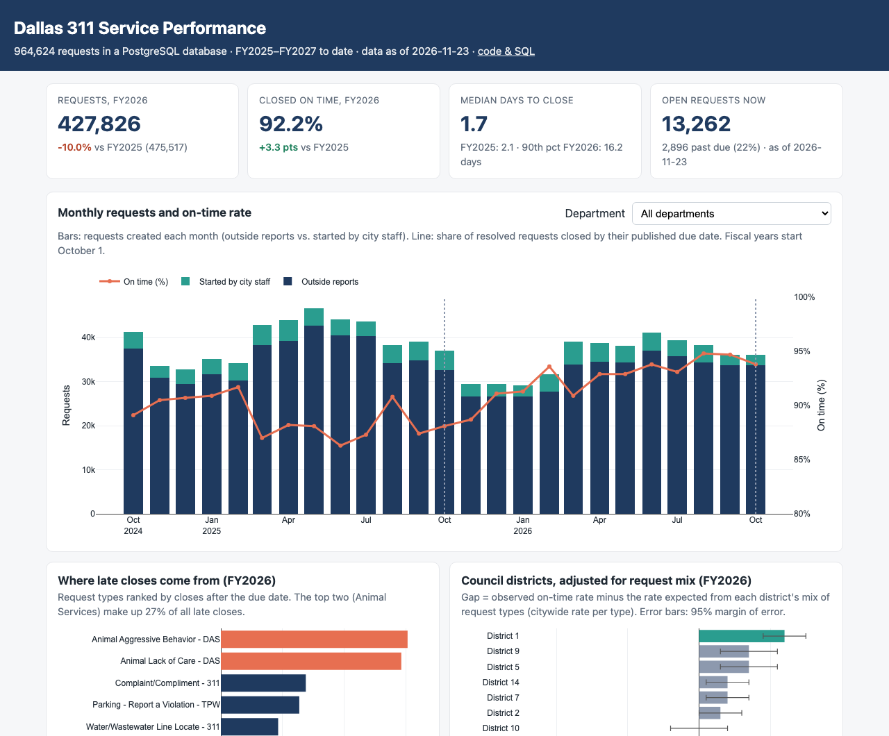
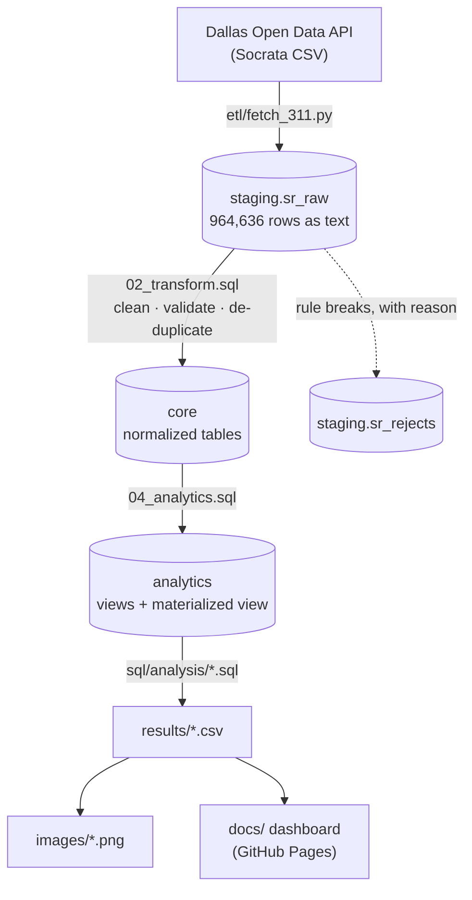
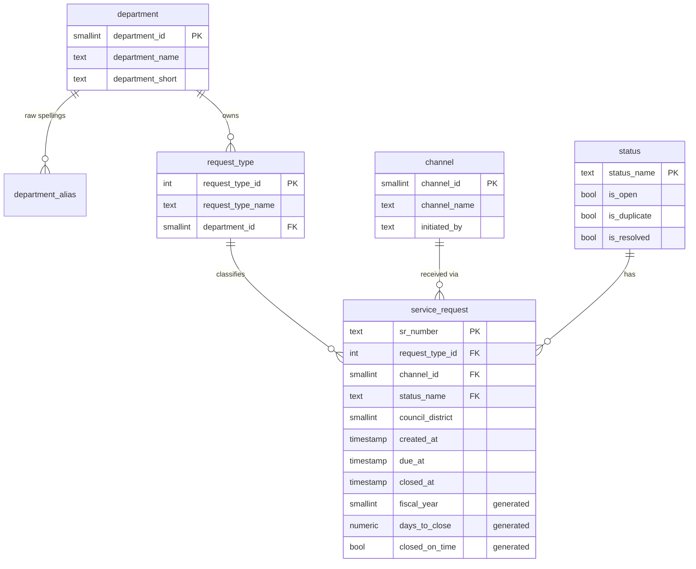
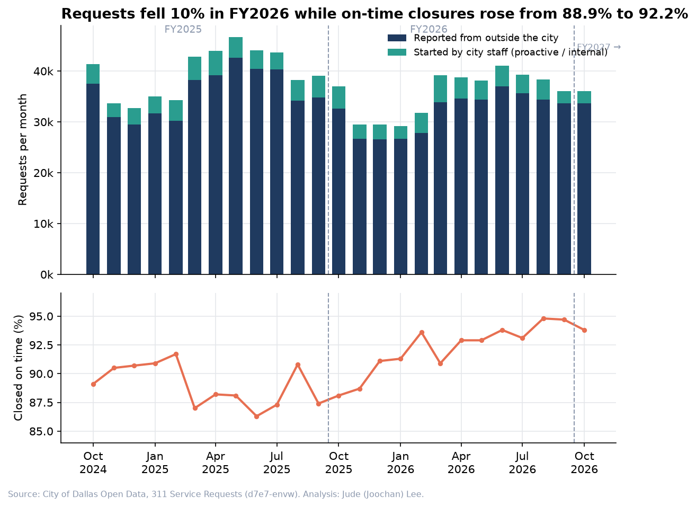
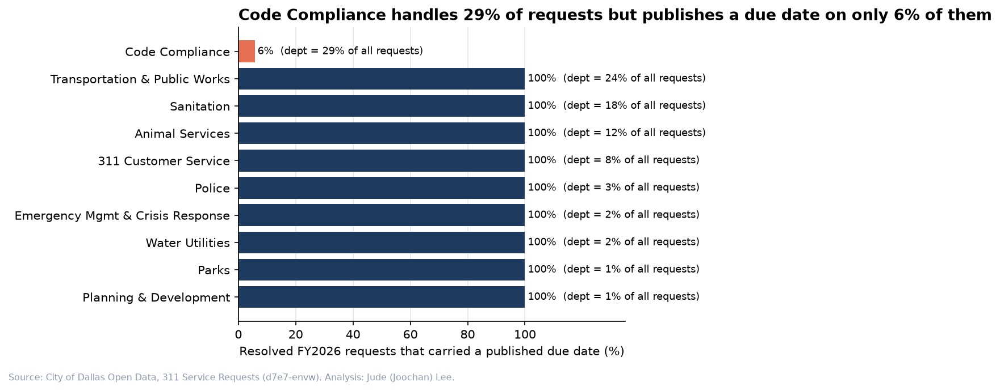
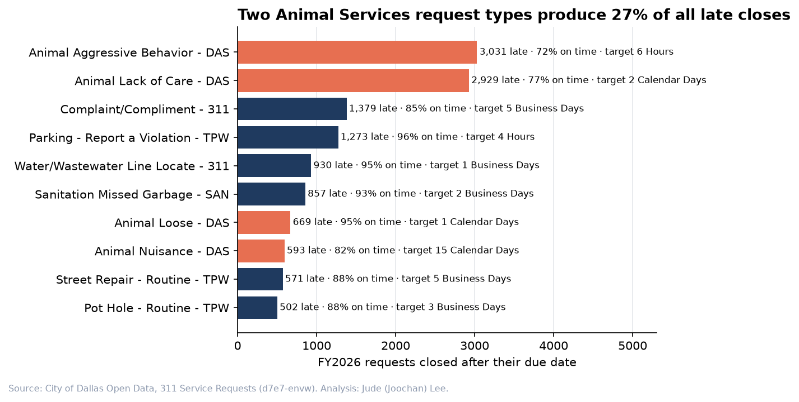
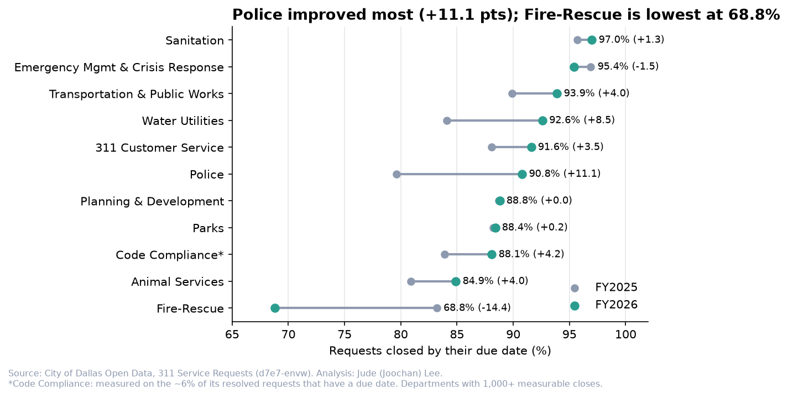
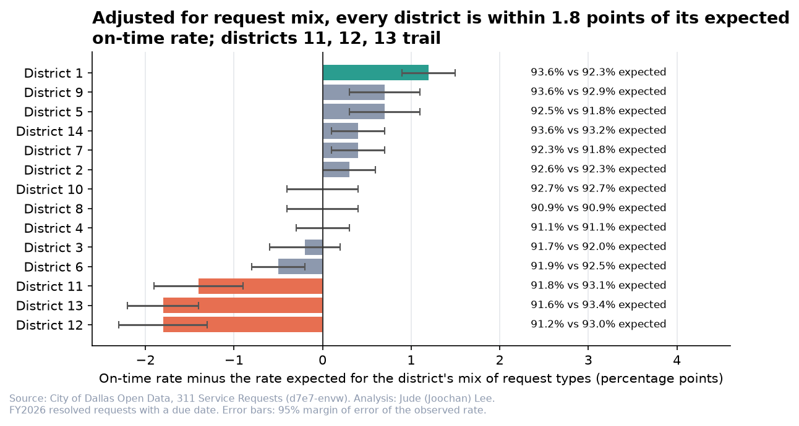
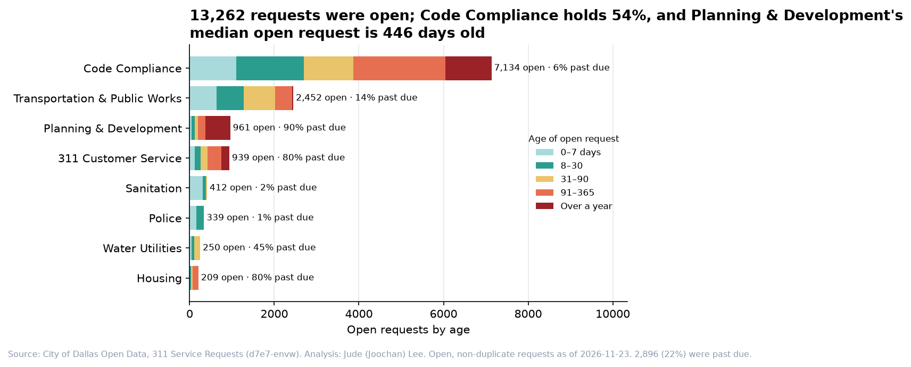
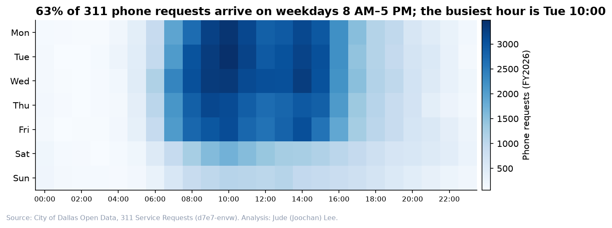

# Dallas 311 Service Requests — PostgreSQL Database & Service-Level Analysis

**How well does the City of Dallas meet its own response targets across ~1 million 311 requests, and where should managers focus first?**

**Live dashboard:** https://ratemyguy.github.io/dallas-311-service-analytics/



**Skills shown:** PostgreSQL database design (staging → normalized core → analytics layer), SQL ETL and data cleaning,
data-quality checks, indexing and a materialized view, least-privilege roles, analytical SQL (CTEs, window functions,
`FILTER` and ordered-set aggregates), KPI design, mix-adjusted comparisons, Python (psycopg `COPY`, pandas, matplotlib),
and an interactive Plotly dashboard published with GitHub Pages.

---

## Business questions

1. How much demand does Dallas 311 handle, and is service getting faster?
2. Which departments and request types miss their published due dates most often?
3. Is service equal across the 14 council districts once you account for what each district reports?
4. How big and how old is the open backlog?
5. When do residents call, and which problems come back after being "fixed"?

## Data

| | |
|---|---|
| Source | City of Dallas Open Data — [311 Service Requests October 1, 2020 to Present](https://www.dallasopendata.com/Services/311-Service-Requests-October-1-2020-to-Present/d7e7-envw) (dataset `d7e7-envw`), public data published by the City of Dallas |
| Pulled | 2026-11-23 15:20 Central (`data/raw/dallas_311/pull_metadata.json` after a fetch) |
| Scope | Every request created on or after Oct 1, 2024 (963,339 rows) plus 1,297 older requests that were still open |
| One row | One service request: type, department, council district, intake channel, status, created / due / closed timestamps, outcome, location |
| Time frame | City fiscal years FY2025 (Oct 2024–Sep 2025) and FY2026 (Oct 2025–Sep 2026); FY2027 to date for the backlog |

The raw CSVs (~285 MB) are not committed; `etl/fetch_311.py` downloads them from the portal's public API.

## Approach



**Database design (`sql/01_schema.sql`).** Three schemas: `staging` keeps every downloaded row as text, `core` holds typed,
de-duplicated data in third normal form, and `analytics` exposes the views that analysts and the dashboard read.



**Pipeline steps**

1. **Load** — `psycopg` streams each CSV into `staging.sr_raw` with PostgreSQL `COPY` (964,636 rows in ~25 s).
2. **Clean and validate** (`sql/02_transform.sql`) — trims text and collapses whitespace including non-breaking spaces
   (20,620 rows affected); parses timestamps, council districts, ZIP codes and coordinates with regex guards so a bad value
   becomes `NULL` instead of failing the load; maps 4 departments the portal spells two ways (e.g. "Sanitation" vs.
   "Sanitation Services") to one canonical name through `core.department_alias` (175,825 rows relabeled); sends 12 rows that
   break a rule to `staging.sr_rejects` with the reason; keeps the newest version of any duplicated request number.
3. **Constrain** — primary and foreign keys, `CHECK` constraints (district 1–14, coordinates inside the Dallas area, a request
   cannot close before it opens), and generated columns for fiscal year, days to close and the on-time flag.
4. **Index and serve** (`03_indexes.sql`, `04_analytics.sql`) — a BRIN index on time, composite and partial indexes (the open
   backlog), a materialized view of monthly department KPIs with a unique index (so it can be refreshed concurrently), and a
   read-only `analyst_readonly` role that sees only the analytics layer (`05_roles.sql`).
5. **Check quality** — `sql/06_data_quality.sql` writes [`results/data_quality.csv`](results/data_quality.csv), one row per
   check with the action taken.
6. **Analyze** — 13 queries in [`sql/analysis/`](sql/analysis) write the CSVs in [`results/`](results); Python draws the charts
   and the dashboard data.

**Definitions.** *On time* = closed at or before the city's published "overall service request due date". On-time rates count
only requests the department resolved (not duplicates, transfers to another agency, or cancellations) **and** that carried a
due date. *Mix-adjusted* district rates use indirect standardization: each district's expected rate applies the citywide
on-time rate of every request type to that district's own mix.

## Key findings

**1. Service got faster while demand fell.** FY2026 brought 427,826 requests, 10.0% fewer than FY2025 (475,517). The share
closed on time rose from 88.9% to 92.2%, the median request closed in 1.70 days instead of 2.09, and the slowest tenth now
take 16.2 days or more (19.8 in FY2025). The gain is mostly real: on the 172 request types measured in both years (92–94% of measurable closes), the on-time
rate rose 3.8 points, of which **3.2 points came from closing the same kinds of requests on time more often and 0.6 points
from a shift toward easier request types** ([decomposition](results/13_on_time_change_decomposition.csv)).



**2. The city's largest workload has no service target in the data.** Code Compliance handled 29.4% of FY2026 requests, but
94.3% of the requests it resolved carried no due date. Its main request type, "Code Concern" (118,350 requests, 27.7% of
everything 311 received), had a measurable due date on only 3 of them and took a median 5.82 days to close. The city's
headline on-time rate therefore says almost nothing about its largest category of work.



**3. Two Animal Services request types produce over a quarter of all late closes.** "Animal Aggressive Behavior" (6-hour
target, 72.3% on time, 3,031 late) and "Animal Lack of Care" (2-day target, 76.6% on time, 2,929 late) account for 26.9% of
the city's late closes in FY2026. Street lighting maintenance has the lowest on-time rate of any type with 1,000+ measured closes (65.0%), and
its late requests closed a median 33.7 days after their due date.



**4. Department trends diverge.** Police (+11.1 points to 90.8%) and Water Utilities (+8.5 to 92.6%) improved most;
Fire-Rescue fell 14.4 points to 68.8% (on 1,143 measured closes).



**5. Districts look different at first, but mostly because they report different things.** Raw on-time rates range from 90.9%
to 93.6%. After adjusting for request mix, every district is within 1.8 points of its expected rate; districts 12 and 13
(−1.8 points) and 11 (−1.4) trail by more than the ±0.5-point margin of error, while District 1 does best (+1.2).



**6. The backlog is small but old in two places.** On Nov 23, 2026, 13,262 requests were open and 2,896 (22%) were past due.
Code Compliance holds 54% of the open requests (1,090 older than a year). Planning & Development has 961 open, 90% past due,
with a median age of 446 days; 311 Customer Service has 939 open, 80% past due.



**7. Calls follow office hours; some problems return.** 63% of FY2026's 209,200 phone requests arrived on weekdays between
8 AM and 5 PM, peaking Tuesday at 10 AM. Phone (48.9%) and API submissions (40.5%) bring in nearly all requests from outside the city;
10.3% were started by city staff themselves. Code Concern
requests are seasonal (in FY2026, June brought 1.9× as many as January), and 14.8% of resolved Code Concerns and 16.1% of
resolved aggressive-animal requests were reported again at the same address within 30 days of closing.



## Recommendations

1. **Give Code Compliance's "Code Concern" requests a published due date.** It is 27.7% of all 311 demand; until it has a
   target, the city cannot report or manage service levels for its biggest category of work.
2. **Target the two Animal Services hotspots** — staff aggressive-animal responses to the 6-hour target (or reset the target
   to what crews can meet and publish that), and review the 2-day lack-of-care target. Fixing these two types alone would
   remove up to 27% of late closes.
3. **Run a backlog clean-up for Planning & Development and 311 Customer Service:** close or re-route the stale, past-due
   records so the open queue reflects real work.
4. **Look inside districts 11–13 before drawing conclusions about staffing:** break their gap down by request type with
   `06_district_equity.sql` as the starting point.
5. **Staff the phones to the weekday 8–5 peak** (Tuesday–Wednesday mornings busiest; Saturday volume is about half a weekday).
6. **Track "reported again within 30 days" next to speed**, so faster closing does not come at the cost of problems returning.

## SQL techniques used (where to find them)

| Technique | File |
|---|---|
| Three-layer schema, identity keys, PK/FK, `CHECK` constraints, generated columns | [`sql/01_schema.sql`](sql/01_schema.sql) |
| Regex parsing, reject table with reasons, `ROW_NUMBER()` de-duplication, data-modifying CTE (`DELETE … RETURNING` → `INSERT`), alias mapping | [`sql/02_transform.sql`](sql/02_transform.sql) |
| BRIN, composite and partial indexes, `ANALYZE` | [`sql/03_indexes.sql`](sql/03_indexes.sql) |
| Views as an access layer, materialized view with a unique index | [`sql/04_analytics.sql`](sql/04_analytics.sql) |
| Least-privilege read-only role | [`sql/05_roles.sql`](sql/05_roles.sql) |
| `LAG` year-over-year, moving average (`ROWS BETWEEN`), `LEAD` for repeats, `DENSE_RANK`, `percentile_cont`, `mode()`, `FILTER` | [`sql/analysis/`](sql/analysis) |
| Indirect standardization (mix-adjusted rates), mix vs. performance decomposition | [`06_district_equity.sql`](sql/analysis/06_district_equity.sql), [`13_on_time_change_decomposition.sql`](sql/analysis/13_on_time_change_decomposition.sql) |

## Repo structure

```
dallas-311-service-analytics/
├── etl/fetch_311.py            download from the Dallas Open Data API (paged CSV)
├── sql/
│   ├── 01_schema.sql           staging / core / analytics schemas, keys, constraints
│   ├── 02_transform.sql        cleaning, validation, rejects, de-duplication, dimensions, fact table
│   ├── 03_indexes.sql          BRIN, composite and partial indexes
│   ├── 04_analytics.sql        analysis views + materialized view
│   ├── 05_roles.sql            read-only analyst role
│   ├── 06_data_quality.sql     data-quality report
│   └── analysis/               13 business queries → results/*.csv
├── src/
│   ├── run_all.py              one command rebuilds everything
│   ├── make_charts.py          README charts
│   └── build_dashboard.py      JSON for the dashboard
├── results/                    query outputs (every number in this README)
├── images/                     charts
└── docs/                       dashboard (index.html + data/dashboard.json), served by GitHub Pages
```

## How to reproduce

You need Python 3.11+ and PostgreSQL 14+ (any local install, or Docker):

```bash
# 1. a PostgreSQL server on port 55432 (Docker example)
docker run --name dallas311-pg -e POSTGRES_HOST_AUTH_METHOD=trust -p 55432:5432 -d postgres:16

# 2. Python environment
python -m venv .venv && source .venv/bin/activate
pip install -r requirements.txt

# 3. download, build the database, run every query, redraw charts and dashboard data (~5 minutes)
python -I src/run_all.py --fetch
```

Use another server with `DATABASE_URL=postgresql://user@host:port/dbname python -I src/run_all.py`. Without `--fetch`, the
pipeline rebuilds from the CSVs already in `data/raw/dallas_311/`. Open `docs/index.html` through any static web server
(e.g. `python -m http.server -d docs`) to see the dashboard locally.

## Limitations & next steps

- **Due dates are the city's own.** On-time rates measure performance against targets the departments publish; a type with a
  generous target can look better than one with a strict target.
- **Right-censoring.** Requests created late in FY2026 that were still open when the data was pulled are not yet in the
  on-time rate; the effect is small two months after year end.
- **"Reported again" is not proof of a failed fix.** It can be a new incident at the same address (parking and utility line
  locates repeat by nature), so it is a screening metric.
- **API is a mixed channel.** It includes resident apps and partner systems (for example utility line-locate requests), so it
  is not split into residents vs. partners here.
- **Next:** per-capita rates with Census population by ZIP, a request-type drill-down for districts 11–13, and a scheduled
  refresh with `REFRESH MATERIALIZED VIEW CONCURRENTLY`.

---

Author: Jude (Joochan) Lee · GitHub [@ratemyguy](https://github.com/ratemyguy) · [LinkedIn](https://www.linkedin.com/in/judeee)
